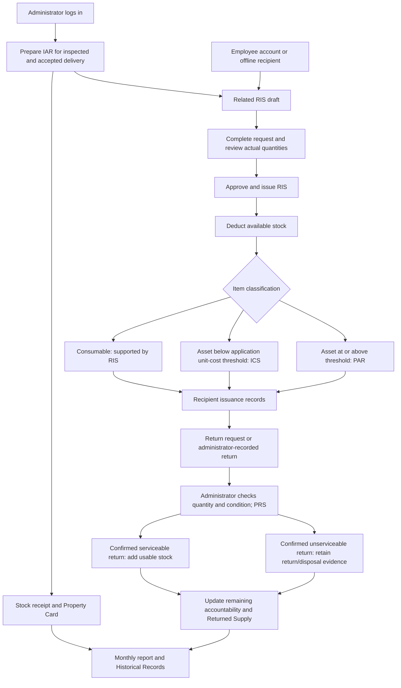

# PAMS: Explanation of the System for Defense

Prepared on October 11, 2026 from the current workspace, including changes that have not yet been committed. This is a presentation guide, not a report of live deployment testing. Field requirements and available actions depend on the document status; complete fields marked as required and supply optional details when applicable.

## 1. System description and purpose

The Property Accountability Management System (PAMS) is a web-based system for a supply or property office. It records incoming supplies and assets, their issuance to employees or office recipients, the person responsible for them, and their subsequent transfer or return. It also prepares supporting documents and provides reports and historical records.

Its main purpose is to answer six questions: What did the office receive? How much stock is available? What was actually issued? Who is accountable? What was returned or transferred? Which document supports the transaction?

The administrator prepares and reviews documents, approves transactions, checks returned items, manages recipients and accounts, and produces reports. A regular user views their own Issued Items and Returned Items and submits return requests. Offline recipients are maintained by the administrator without creating login accounts.

Suggested opening statement:

> Our system helps the supply office manage the receipt, issuance, custody, and return of government items. Its main improvement is connecting the documents to the actual stock movement and responsible recipient. This helps staff trace an item from receipt to issuance and verified return while keeping supporting documents available for review.

## 2. Flow of forms

1. Identify the recipient through an employee account or an Offline Record.
2. Prepare the IAR when a delivery has been inspected and accepted. The stock-receipt process creates related stock records, a Property Card, and a RIS draft.
3. Review the Property Card for the recorded receipt and movement balance.
4. Complete the RIS with the requesting recipient, purpose, items, quantities, and signatories.
5. Review available stock and decide the actual quantity to issue. Approval/issuance posts the related stock and accountability changes.
6. Consumables use RIS. Assets generate ICS or PAR using the application's unit-cost classification rule.
7. The user sees their issued items. For offline recipients, the administrator uses View Records.
8. A user sends a return request. It remains pending until the administrator checks and confirms actual receipt.
9. PRS records the return, condition, quantity, and responsible signatories. Serviceable returns restore available stock; unserviceable returns do not restore usable stock.
10. Returned Supply keeps item-level return details. Partial returns leave the remaining quantity accountable to the recipient.
11. Monthly Reports and Historical Records help staff review and retrieve supporting information.

PTR is a separate branch for movement between accountable officers. In the linked transfer workflow, receiver confirmation and administrator approval precede reassignment. The ordinary user's current routes do not expose the transfer page, so a complete user-operated transfer should be presented as awaiting interface integration.

## 3. Common information and buttons

Entity Name or LGU identifies the organization. Fund Cluster identifies the funding source. Office, Division, and Responsibility Center Code identify the organizational unit. Document numbers and dates allow retrieval and cross-reference. Stock, inventory, and property numbers identify recorded items; serial numbers identify particular physical units where applicable. Names, designations, and dates identify the people responsible for each stage.

| Button or control | Purpose |
| --- | --- |
| New Form | Opens an empty document editor. |
| Add item / Add PPE | Adds another item row. |
| Remove/Delete row | Removes a row from the editor where supported; this is not deletion of a completed stock transaction. |
| Save / Create | Validates and stores the document; stock effects depend on the module and its workflow links. |
| Edit / Open form | Opens a saved document for review or allowed corrections. |
| Update / Save Changes | Saves permitted changes. Completed workflow details can be locked. |
| Approve / Issue / Confirm Receipt | Performs the specific workflow decision shown by the page. |
| Reject | Declines the request or transaction; provide a reason where required. |
| PDF | Downloads the document. |
| Print / Print Preview | Opens printable output or previews the layout. |
| Search / filters | Narrows the records displayed. |
| Previous / Next / page size | Moves through saved records or changes the number displayed. |
| Refresh / Retry | Reloads current information or retries a failed request. |
| Close / Cancel | Leaves the editor or cancels the current selection. |

These controls are shared patterns, not buttons available on every page. For example, Returned Supply principally provides editing rather than the official slip pages' PDF/Print actions.

## 4. Explanation of each form and page

### 4.1 Login

**Purpose:** Identify the person and open the appropriate workspace.

**Information:** Username and password.

**Buttons:** Login submits credentials. Password visibility shows or hides the password. Register opens registration; Forgot Password opens recovery.

**Defense explanation:** Authentication identifies the account, while role restrictions control the pages it can access.

### 4.2 Registration Request

**Purpose:** Let an employee request an account for administrator review.

**Information:** First name, optional middle name, last name, email, username, LGU office, division/unit, position, password, and password confirmation.

**Buttons:** Send Registration Request submits the details. The login link returns to sign-in. Approve and Reject are available to the administrator in User Management.

**Defense explanation:** Submitting registration does not immediately grant access. The administrator checks whether the requester should receive an account.

### 4.3 Forgot Password and Reset Password

**Purpose:** Recover access to an existing account.

**Information:** Username or email for the recovery request; a valid reset link, new password, and confirmation for reset.

**Buttons:** Recovery submission requests a reset; reset submission saves the new password; login links return to sign-in.

**Defense explanation:** Ordinary account recovery enters an administrator approval queue. Approval sends a one-use email reset link. Administrator accounts use direct email recovery. Email sending depends on configured mail settings.

### 4.4 Dashboard

**Purpose:** Give the administrator an overview of records and access to modules.

**Information:** Record totals, summaries, and recent activity. There is no delivery or issuance data-entry form here.

**Buttons:** Module cards and navigation links open the corresponding pages.

**Defense explanation:** The dashboard provides an overview; supporting documents contain transaction details.

### 4.5 Inspection and Acceptance Report — IAR

**Purpose:** Document the inspection and acceptance of an incoming delivery.

**Information:** Entity name, fund cluster, supplier, PO/JO number and date, responsibility center code, IAR number and date, invoice number and date; item stock/property number, description, unit, quantity, classification, costs, and applicable serial details; inspection date and officer/committee; receipt date, acceptance status, partial acceptance details when applicable, and supply/property custodian.

**Buttons:** New Form opens a receipt; Add item adds delivery lines; Save IAR posts a new receipt; Update IAR saves allowed corrections; Edit opens a saved report; PDF and Print produce the document; Close exits the editor.

**Result and defense:** A stock receipt establishes the source of available stock. It creates the related Property Card and RIS draft. It does not immediately assign the whole delivery to an employee through ICS/PAR. Posted receipt quantities and costs have restrictions to prevent changing the original stock movement.

### 4.6 Property Card

**Purpose:** Record item movements and balances.

**Information:** Month, PO number, entity name, fund cluster, property/plant/equipment name, property number, description, and optional serial number. Movement rows contain date, PAR reference, receipt quantity, issue/transfer/disposal quantity, office/officer, balance quantity, amount, and remarks.

**Buttons:** New Form, Add item, Save New Form or Update Property Card, Edit, PDF, Print, and Close. Search and paging locate saved cards.

**Defense explanation:** IAR explains where the item came from. The Property Card shows its recorded movements and balance. A manually entered card must be distinguished from an automatically linked stock movement.

### 4.7 Requisition and Issue Slip — RIS

**Purpose:** Record what the recipient requests and what the supply office actually issues.

**Information:** Entity name, fund cluster, office, division, responsibility center code, RIS number, date, purpose, and linked user account or offline recipient. Item rows contain stock number, unit, description, quantity requested, availability, actual quantity issued, and remarks. Requested By, Approved By, Issued By, and Received By contain the relevant names, designations, and dates.

**Buttons:** New Form and row controls prepare the request. Save Request stores it. Review & Fulfill opens stock review; Save Review stores reviewed quantities; Issue RIS performs issuance. Edit/Update RIS supports pending-document changes. Approval/rejection actions depend on status. PDF, Print, and Close support document review.

**Result and defense:** Actual issuance deducts stock and creates applicable asset accountability documents. A request for five units is different from an actual issue of three. The system checks stock again when issuance is approved.

### 4.8 Inventory Custodian Slip — ICS

**Purpose:** Identify the custodian of an asset falling below the application's unit-cost threshold.

**Information:** Entity name, fund cluster, ICS number, office, quantity, unit, unit cost, total cost, description, inventory item number, estimated useful life, and Received From/Received By names, positions, and dates.

**Buttons:** New Form, Add item, Save New Form, Save Changes, Open form/Edit, PDF, Print, and Close. Issuance-generated documents may be locked.

**Result and defense:** The current application generates ICS for assets below PHP 50,000 per unit. Two assets costing PHP 30,000 each use this rule even though their combined value is PHP 60,000. This describes the application's classification, not verification of the legal threshold for every organization.

### 4.9 Property Acknowledgement Receipt — PAR

**Purpose:** Identify the person accountable for an asset falling at or above the application's unit-cost threshold.

**Information:** Entity name, fund cluster, PAR number, office, quantity, unit, description, property number, acquisition date, amount, and Received By/Issued By names, positions, and dates.

**Buttons:** New Form, Add item, Save New Form, Save Changes, Open form/Edit, PDF, Print, and Close. Issued workflow forms restrict edits.

**Result and defense:** Assets costing PHP 50,000 or more per unit generate PAR under the current rule. Consumables do not become accountable assets merely because their price is high. Standalone PAR preparation is different from linked issuance that changes stock and accountability.

### 4.10 Property Transfer Report — PTR

**Purpose:** Document movement from one accountable officer to another.

**Information:** Entity name, fund cluster, PTR number, sending and receiving accountable officers, date, transfer type, reason, and remarks. Types include Donation, Reassignment, Relocation, and Other. Items contain acquisition date, property number, description, amount, and condition. Approved By, Issued By, and Received By identify signatories, designations, and dates.

**Buttons:** New Form, Add item for standalone documents, Create PTR, Update PTR, Open transfer form, PDF, Print, and Close. Linked records expose approval/rejection controls when their state permits.

**Defense explanation:** In the linked workflow, pending transfers retain the original custodian's accountability until receiver confirmation and approval. Saving a standalone PTR should not be described as automatically reassigning live accountability. Ordinary-user transfer access still needs interface integration.

### 4.11 Property Return Slip — PRS

**Purpose:** Record and verify physical return of previously issued items.

**Information:** LGU, PRS number, purpose such as Disposal, Repair, Returned To Stock, or Other; returning account and exact issued item; quantity, unit, description, property number when applicable, M.R./document reference, unit value, calculated total value, condition, and optional note. Returned By and Returned To contain names, designations, and dates.

**Buttons:** New Form, recipient/issued-item selectors, Add item when permitted, Create PRS, Update PRS, Open return form, PDF, Print, and Close. Pending returns use condition/decision controls and Confirm Receipt or Reject PRS. Rejection requires a reason.

**Result and defense:** Confirmation reduces remaining accountability. A confirmed serviceable item increases available stock; an unserviceable item is recorded without increasing usable stock. Partial returns retain the remaining accountability. Completed workflow quantities are locked, and repeat confirmation cannot add stock twice.

### 4.12 Returned Supply

**Purpose:** Keep item-level information about returned supplies or assets, including entries generated from PRS.

**Information:** Linked issued item and recipient where available, LGU, purpose, quantity, unit, description, property number when applicable, M.R. reference, unit value, total value, optional note, and Returned By/Returned To details.

**Buttons:** New Form, Edit, recipient/item selectors, Save New Form, Save Changes, Close, search, and paging.

**Defense explanation:** PRS is the supporting return slip; Returned Supply holds the returned-item record. Linked mirrored records represent one return. Correct a PRS-generated row through its Return Slip. An unlinked historical entry does not automatically change inventory.

### 4.13 User Issued Items

**Purpose:** Let users view requests and issuances associated with their account.

**Information displayed:** Item details, request/issue references, status, requested quantity, actual issued quantity, and linked asset documents where applicable.

**Buttons:** Refresh reloads information. Ordinary users do not prepare administrative RIS documents on this page.

**Defense explanation:** The user can distinguish a pending request from actual issued stock and see the document supporting custody.

### 4.14 User Returned Items

**Purpose:** Let the user submit returns and follow their status.

**Information:** The selected issued item and quantity to return, within the remaining quantity. Linked details are supplied by the system.

**Buttons:** Send return to admin submits the request; Refresh reloads records. Sent to admin indicates a pending request.

**Defense explanation:** User submission records intent to return. It does not establish physical receipt or immediately restore stock.

### 4.15 Offline Records

**Purpose:** Track office recipients who do not have login accounts. Open it through the administrator's account menu.

**Information:** Recipient name and office are required. Designation and notes are optional. An item request also needs selected stock items and positive whole-number quantities within available stock.

**Buttons:** Add Offline Record opens the directory form; Save Offline Record stores it; Cancel closes it; Edit corrects directory details. Request Item selects a recipient and opens stock selection. Checkboxes choose items; quantity fields specify requested amounts. Refresh Stock reloads availability; Open Requisition opens a prefilled RIS; Cancel Selection clears the selection. View Records shows requests, issued items, and returns. In that dialog, Returned records an administrator-confirmed return using the entered quantity and condition.

**Result and defense:** These recipients use the existing RIS review and issuance process. Asset documents retain the offline recipient reference. Administrator-recorded returns create PRS and update accountability, adding stock only for serviceable items. Here, offline means a recipient without an account; it does not mean the application works without internet or server access.

### 4.16 Monthly Items Report

**Purpose:** Consolidate recorded source items for a selected month and prepare supporting report output.

**Information:** Month, LGU, fund, serial/report number, report date, source-derived item rows, recapitulation, supply/property custodian, accounting staff, and posting date. Rows include RIS/reference details where available, stock number, item, unit, quantity, unit cost, and amount.

**Buttons:** Month selects the period; Refresh reloads source information; New Form prepares a separate saved copy; View opens a saved report; Save New Form or Save Report Details stores permitted report details; Print Preview, PDF, Print, and Close preview control output.

**Defense explanation:** Automatic reports reuse stored source data. A saved copy retains its copied rows. The current collector includes receipts and other recorded movements, so the printed word 'Issued' must not be presented as proof that every row is a completed issue. It is also not a physical stock count.

The main amount is quantity multiplied by unit cost when cost is available. Recapitulation groups matching stock number, item, and unit and adds quantities; its unit-cost and total-cost columns intentionally remain blank. Missing cost is different from a known zero cost.

### 4.17 List of Property, Plant and Equipment — List of PPEs

**Purpose:** Prepare an organized list of equipment and accountable persons.

**Information:** LGU, PPE account group, date, article/item, description, property number, accountable person, unit cost/value, total cost/value, optional remarks, and preparer/reviewer names and designations.

**Buttons:** New Form, Add PPE, row deletion controls, Save List of PPEs, Edit, Print Preview, PDF, Print, and Close preview.

**Defense explanation:** It supports equipment reporting but does not itself prove physical inspection. Unit cost and total cost are entered separately because this form has no quantity column; the preparer uses supporting records to enter the correct total.

### 4.18 Historical Records

**Purpose:** Retrieve earlier documents and inspect supporting records.

**Information:** Selected year, document folder/type, applicable condition filter, and search terms such as reference number, item, office, or employee. Folders include IAR, Property Card, RIS, ICS, PAR, PTR, PRS, Returned Supply, PPE lists, and Monthly Reports.

**Buttons:** Year/type/condition controls filter records; Search finds matches; View record opens details; related-history links open connected evidence; Download PDF exports supported records; Close exits details.

**Defense explanation:** Folder counts are document counts. One document may contain several items, so file counts are different from stock quantities.

### 4.19 User Management

**Purpose:** Create and manage accounts and review registration and password-recovery requests.

**Information:** First name, last name, email, username, password for a new account, office, division, and account type. Administrator creation also uses the confirmation fields supplied by its dialog. Editing can leave the password blank to retain it.

**Buttons:** Add User and Add Admin open account forms. Create User Account/Create Admin Account creates an account; Save Account Changes saves editing; Cancel/Close leaves the dialog. Account actions include View Records, editing, and Lock/Unlock. Registration and recovery queues have Approve/Reject. Previous/Next pages through accounts. View Records also supports administrator-recorded returns with quantity and condition.

**Defense explanation:** Account IDs preserve record ownership when names change. Locking prevents access while retaining the person's records. Approval screens help the administrator control access and recovery.

### 4.20 Suppliers

**Purpose:** Store supplier reference details.

**Information:** Supplier name, address, and contact number.

**Buttons:** New supplier, Save Supplier, and Retry when a load fails.

**Availability:** The route exists but the current main sidebar does not expose it. Confirm navigation before including it in the demonstration.

### 4.21 My Profile, About, and navigation

**My Profile:** Displays the administrator's identity, office, email, username, division, role, account status, and membership date. Its picture control uploads/changes a JPG, PNG, or WebP image up to 2 MB. It is not a general account-details editor.

**About:** Explains the system and identifies the developers. Administrative developer-profile tools manage presentation details where exposed.

**Navigation:** Menu expands/collapses navigation; group controls expand document lists; account controls open authorized account pages and Offline Records; Logout ends the session.

## 4A. Quantity, unit cost, computations, and their flow

Use these explanations alongside the corresponding forms above. Unit means how something is counted, such as piece or box. Quantity means how many of those units are recorded. Unit cost means the recorded price of one counting unit; a box price should not be treated as a piece price without converting the quantity and price consistently.

### IAR: receiving items

- **Quantity:** The number of units recorded as received in the posted receipt. Enter it from the checked delivery; it is not the number an employee requested.
- **Unit Cost:** The recorded purchase cost of one unit. Enter the known purchase price so the recorded valuation is accurate.
- **Row Total:** `Quantity × Unit Cost`. For example, five printers at PHP 20,000 each have a row total of PHP 100,000.
- **Document Total:** Add the calculated item-row totals. The IAR/ICS/PAR calculation rounds each row to two decimal places before adding the rows.
- **Stock Flow:** `Previous available stock + Posted receipt quantity = New available stock`. If stock was two and the posted receipt adds five, available stock becomes seven.
- **Blank Cost:** In the current IAR workflow, a blank cost uses the existing stock price, or zero for a new stock item. The editor initially shows zero for a blank cost until the saved price is returned. A blank entry therefore should not be explained as proof that the item was acquired free of charge.
- **Next Step:** Receipt creates the related stock records, Property Card, and RIS draft. It does not issue the received quantity to a person. Posted receipt quantities and costs are locked against changes that would alter the original movement.

### Property Card: recording movements and balance

- **Receipt Quantity:** The quantity recorded as coming into the tracked stock/property record.
- **Issue Quantity:** The quantity recorded as going out through issuance.
- **Balance Example:** Start with zero, receive five, and issue two: `0 + 5 - 2 = 3` available units. A later confirmed serviceable return of one makes available stock `3 + 1 = 4`.
- **Transfer Quantity:** Identifies the quantity moved between custodians. Transferring an already issued asset changes its custodian; it does not automatically add that quantity to available warehouse stock.
- **Amount:** The recorded value associated with the movement. Explain it using the supporting transaction; not every manually entered Property Card amount is automatically calculated from quantity.
- **Entry Behavior:** A standalone card can contain manually entered movement and balance information. Distinguish this from linked workflow records that are generated as part of stock transactions.

### RIS: requested quantity versus actual issued quantity

- **Quantity Requested:** What the recipient asks for. Saving a request does not deduct this quantity from stock.
- **Quantity Issued:** What the administrator actually releases after review. This is the quantity used for the stock deduction and linked asset documents.
- **Stock Formula:** `Available stock before issuance - Actual quantity issued = Available stock after issuance`.
- **Example:** Stock is five printers; the recipient requests four, but the administrator issues two. Available stock becomes `5 - 2 = 3`. The recipient is accountable for two, not four.
- **Insufficient Stock:** The system checks stock at issuance. It prevents a stock deduction exceeding available stock rather than completing an unsupported movement.
- **Cost Flow:** Linked issuance uses the unit cost from the source inventory receipt. Generated ICS/PAR values use that cost and the actual quantity issued.
- **Repeat Action:** An already completed issuance cannot deduct the same stock again.

### ICS: calculating the value entrusted to the custodian

- **Quantity:** The number of asset units actually assigned through the linked issuance, or entered on a standalone document.
- **Unit Cost:** The recorded value of one asset unit.
- **Total Cost:** `Quantity × Unit Cost`. Two printers at PHP 20,000 each have a total cost of PHP 40,000.
- **Document Total:** Add the rounded total costs of the item rows. The server recalculates amounts when saving.
- **Classification:** The current application uses ICS for assets below PHP 50,000 per unit. Three assets at PHP 20,000 each still use ICS even though their row total is PHP 60,000.
- **Stock Flow:** Linked RIS issuance performs the stock deduction. Its generated ICS documents custody; it does not deduct the same quantity a second time. Saving a standalone ICS calculates its values without posting a stock movement.

### PAR: calculating the value of accountable property

- **Quantity:** The number of property units assigned to the recipient.
- **Unit Cost:** The recorded value of one unit. The current PAR editor accepts unit cost even though the exported document shows the Amount column.
- **Amount:** `Quantity × Unit Cost`. Two assets at PHP 60,000 each have an amount of PHP 120,000.
- **Document Total:** Add the rounded item-row amounts. The server recalculates amounts on save.
- **Classification:** The current application uses PAR for assets at PHP 50,000 or more per unit. Exactly PHP 50,000 per unit falls under PAR.
- **Older Records:** Older PAR rows without unit cost retain their recorded amounts. When opened in the editor, unit cost can be obtained as `Stored Amount ÷ Quantity`, allowing permitted later edits to recalculate the amount.
- **Stock Flow:** The linked RIS issuance deducts stock. Generated PAR records the resulting accountability without another deduction. A standalone PAR does not itself issue stock.

### PTR: moving accountability

- **Transferred Items/Quantity:** In a linked transfer, identify the assets being moved from the original custodian. The standalone printed form mainly identifies them through property number, description, and amount; it should not be described as a quantity-and-unit-cost calculator.
- **Amount:** The recorded value of the transferred property, rather than a newly calculated purchase price.
- **Custody Flow:** Pending transfer retains original accountability. Receiver confirmation and administrator approval complete the reassignment in the linked workflow.
- **Stock Example:** If warehouse stock is three and two already issued printers move from Employee A to Employee B, warehouse stock stays three. The change concerns who holds those two issued printers.

### PRS and Returned Supply: returned quantity and value

- **Return Quantity:** The number of issued units physically returned. It must fit within the remaining quantity eligible for return.
- **Unit Value:** The recorded value of one returned unit; it is not a newly assessed market or depreciated price.
- **Total Value:** `Returned Quantity × Unit Value`. One returned printer valued at PHP 20,000 has a return value of PHP 20,000.
- **Remaining Accountability:** `Previous remaining issued quantity - Confirmed return quantity = New remaining accountable quantity`.
- **Partial Return Example:** A recipient holds two printers and returns one. After confirmation, they remain accountable for one.
- **Serviceable Stock Flow:** `Previous available stock + Confirmed serviceable return quantity = New available stock`. If stock is three and one serviceable printer is returned, stock becomes four.
- **Unserviceable Stock Flow:** Confirmed unserviceable returns reduce the recipient's remaining accountability but do not increase usable stock. In the same example, usable stock stays three.
- **Pending Request:** A user's return submission alone does not change stock or complete the reduction of accountability. Administrator confirmation establishes receipt. The administrator's Returned action in View Records records receipt directly.
- **Linked Records:** A PRS and its mirrored Returned Supply record represent one return, not two additions to stock. Repeat confirmation must not post the return again.

### Monthly Report: row amounts and grouped quantities

- **Quantity:** Comes from the included source record. Because the current collector includes different kinds of recorded movements, it is not automatically an issued-only quantity or current stock balance.
- **Unit Cost:** Comes from source data where available. If a source provides total value and a positive quantity but no unit cost, the system can derive `Unit Cost = Source Total Value ÷ Quantity`.
- **Row Amount:** `Quantity × Unit Cost`. Four units at PHP 250 produce PHP 1,000.
- **Main Total:** Add row amounts with known costs. Missing cost stays blank rather than being represented as a known zero. If every cost is missing, the main total stays blank.
- **Recapitulation Quantity:** Add quantities with matching stock number, item, and unit. For example, paper with matching identifiers in quantities two, three, and one has a recap quantity of six.
- **Recapitulation Costs:** Unit Cost and Total Cost intentionally stay blank. Do not describe them as automatically calculated totals.
- **Stock Effect:** Creating or printing the report does not receive, issue, or return stock.

### List of PPEs: separately entered values

- **Unit Cost/Value:** The recorded value of one equipment unit.
- **Total Cost/Value:** Entered separately using supporting records. This form has no quantity column, so it does not automatically multiply quantity by unit cost.
- **Example:** For one printer valued at PHP 20,000, unit and total values may both be PHP 20,000. If a row represents two printers at that price, the preparer must support and enter the PHP 40,000 total.
- **Stock Effect:** Saving this list does not change stock or custody.

### Offline Records and user return quantities

- **Offline Requested Quantity:** Choose a positive whole number within displayed available stock. Open Requisition carries the selection into RIS; selection itself does not deduct stock. Issuance checks availability again.
- **User Return Quantity:** Enter the quantity to return from the user's eligible remaining issued items. Send return to admin creates a pending request.
- **Administrator Return Quantity:** In View Records, enter the physically received quantity and select its condition before Returned. This records a confirmed return and applies the serviceable/unserviceable rules above.

**Defense script:**

> Quantity tells us how many units are involved, while unit cost gives the recorded value of one unit. For IAR, ICS, and current PAR entries, the row value is quantity multiplied by unit cost. Receipt adds stock, actual issuance deducts stock, and a confirmed serviceable return adds stock back. A transfer changes the custodian of already issued property without automatically changing warehouse stock. Requested quantities, issued quantities, and returned quantities represent different stages, so we record them separately.

## 5. Additions and improvements to explain

The comparison below uses recent repository changes and their documented improvement targets. It does not claim that every feature was absent from every earlier version or that a measured efficiency gain has already been demonstrated.

| Improvement target | Current addition or improvement | Reason for the improvement |
| --- | --- | --- |
| Separate stock receipt from custody assignment | IAR produces stock records, Property Card, and RIS draft; issued assets generate ICS/PAR. | Items should become a person's accountability when issued, rather than when delivered to storage. |
| Distinguish supplies and assets | Consumables and assets receive different document treatment; asset classification uses unit cost. | Avoids inappropriate accountability forms and classification based only on a request's combined value. |
| Identify the correct recipient | Explicit account selection and stable account IDs. | Names may change or be shared by multiple people. |
| Include recipients without accounts | Offline Records, stock selection, prefilled RIS, and recipient record viewing. | The supply office can retain accountable records without requiring every recipient to log in. |
| Preserve reliable stock and accountability | Related stock/custody changes use transactions and repeat-action protection. | Prevents unmatched related updates and repeated deductions or additions. |
| Verify returns | Administrator confirmation, serviceable/unserviceable conditions, and partial-return handling. | A request alone does not prove receipt; unusable stock must not appear available. |
| Make returns easier to record | Account and offline-recipient View Records support administrator-recorded returns. | Staff can record received returns alongside the person's existing issuance evidence. |
| Improve document completeness | Frontend and backend validation, calculated values where supported, and controlled document numbering. | Reduces missing details, calculation inconsistencies, and duplicate references. |
| Control account access | Approved registration, account locking, Add Admin, and approved user password recovery. | Gives the office control over account creation and recovery. |
| Reduce repeated reporting entry | Source-derived monthly reports and searchable historical folders. | Reuses stored evidence and makes earlier documents easier to retrieve. |
| Improve document output | Consistent A4 PDF, print, and preview layouts. | Helps staff review and produce readable documents. |
| Make entry clearer on different screens | Responsive forms/tables, readable text, row controls, and loading/validation feedback. | Helps users understand the current action and locate incomplete fields. |

The latest reviewed commits include workflow/PDF/interface changes, form validation and account-management changes, and administrator-approved registration. Offline-recipient and other newer changes are present in the working files; their presence here does not establish that the deployed site has been updated.

## 6. Defense of the suggested improvements

Use this explanation pattern: **problem → change → resulting behavior → evidence**.

**Suggestion: Connect the forms instead of repeatedly entering unrelated records.**

> We addressed this by linking stock receipt, RIS issuance, recipient ownership, and verified returns. For example, an approved asset issue creates its custody document, and a confirmed return refers to the issued item. During demonstration, we will show the document references and remaining quantity across those stages.

**Suggestion: Clarify who is responsible for an item.**

> We use a selected account or an offline-recipient record rather than relying only on a typed name. The recipient reference remains linked to the transaction, which makes ownership clearer when names are similar or later change.

**Suggestion: Include offices or recipients without system accounts.**

> Offline Records provides a recipient directory without passwords or login access. The administrator selects available items and opens a prefilled RIS. Issuance still follows the stock review and approval process, and returns are recorded against the recipient's issued items.

**Suggestion: Improve return accuracy.**

> We distinguish a return request from a received return. The administrator checks quantity and condition before posting it. A partial return reduces only that quantity, and an unserviceable item does not increase usable stock.

**Suggestion: Improve reporting and document preparation.**

> Monthly reports reuse recorded source items, while historical folders help locate supporting forms. Shared PDF layouts produce consistent A4 output. We explain the monthly report's source scope clearly because its present data collection includes several types of recorded movement.

**Suggestion: Add automatic property codes, physical inventory history, or QR labels.**

> Property-lifecycle functionality exists in source, but its Property Register page is not connected to the current application routes. QR-assisted identification is a proposed extension. We will treat these as future integration work until they are accessible, tested, and demonstrated.

## 7. Demonstration example

Assume there are no existing printers in stock. The administrator receives five printers costing PHP 20,000 each.

| Stage | Example result |
| --- | --- |
| IAR | Receive five printers; recorded value is PHP 100,000. |
| Property Card | Receipt of five; available stock becomes five. |
| RIS issuance | Issue two printers; available stock becomes three. |
| ICS | Unit cost is below the application's threshold; recipient holds two printers worth PHP 40,000. |
| Return request | Recipient requests return of one; submission alone leaves stock unchanged. |
| Confirmed serviceable PRS | Remaining accountability becomes one printer; available stock becomes four. |
| Alternative: confirmed unserviceable PRS | Remaining accountability becomes one; available usable stock stays three. |
| Returned Supply/history | Keep the returned item's details and supporting return document. |

Show the same flow for an offline recipient through administrator View Records. Explain that an administrator's Returned action records receipt directly, whereas a user's Send return to admin action creates a pending request.

## 8. Likely defense questions

**What is the principal improvement?**

Connected accountability: receipt, actual issuance, responsible recipient, and verified return are linked to supporting documents and remaining quantities.

**Why keep several forms?**

Each form records a different event and responsible people. Combining their data does not remove the need to distinguish acceptance, issuance, custody, transfer, and return.

**How do you prevent duplicate posting?**

Issuance and return confirmation check transaction state and protect against repeat posting. Linked PRS and Returned Supply entries are treated as evidence of one return.

**What happens if a critical update fails?**

Critical related stock/custody writes use database transactions so they commit together or roll back together. The deployment must use MongoDB with transaction support.

**Does Offline Records work without internet?**

The feature records recipients who have no login account. It still uses the application and backend; its name does not promise disconnected operation.

**Does the system perform physical inspection?**

Staff perform inspection. The system stores their findings, quantities, conditions, signatories, and document references.

**Can you claim a specific time saving?**

The design reduces repeated entry and provides faster retrieval paths, but a percentage or measured time saving requires timed user evaluation.

**What remains to improve?**

Complete ordinary-user transfer/acceptance interface integration, expose and validate the Property Register, refine the monthly report to match its intended issued-only scope if required, and evaluate QR identification with actual office workflows.

**How should alignment with government procedures be described?**

Say the system is designed to support property-accountability procedures through identifiable recipients, movement documents, and retained history. Verification of applicable official forms, thresholds, and procedures remains an organizational review task.

## 9. Closing presentation script

> Our improved system connects the supply office's records from receipt to issuance and return. IAR records inspected and accepted deliveries, the Property Card shows movements, and RIS records the request and actual issue. ICS and PAR identify asset custody using the application's unit-cost rule. PRS verifies returns, and Returned Supply preserves their item details. Offline Records includes recipients without accounts. The improvements focus on traceable ownership, accurate remaining quantities, controlled decisions, and accessible documents. Features still awaiting interface integration will be presented as future work.

## 10. Sources in this project

- Current routes: `frontend/src/App.jsx`.
- Navigation and account menu: `frontend/src/components/Layout.jsx`.
- Forms: `frontend/src/pages/` and corresponding models/routes in `backend/src/`.
- Existing detailed explanation: `docs/SYSTEM-DEFENSE-GUIDE.md`.
- Field meanings and calculations: `docs/FORMS-BASIC-ENGLISH-GUIDE.md` and `docs/form-computations.md`.
- Offline-recipient workflow: `docs/offline-records.md`.
- Linked receipt, issuance, transfer, and return behavior: `docs/custody-workflow.md` and the corresponding backend implementation.

Annual Reports appear in older documentation and source files, but are absent from the current active route map. Settings redirects to the role's landing page. Unrouted pages should not be counted as accessible modules in the defense.
