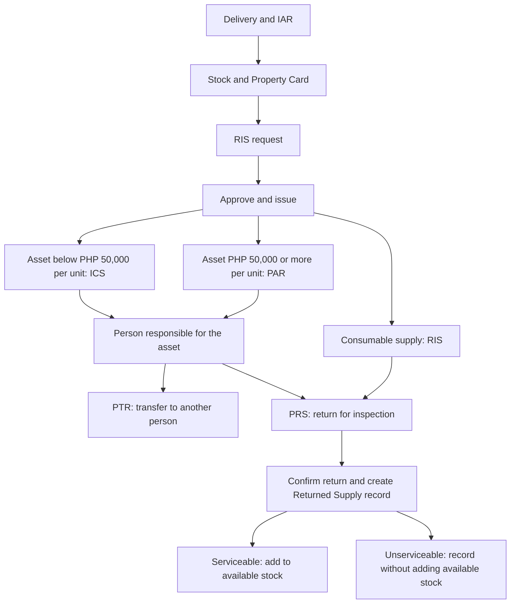

# Forms, data, flow, and calculations

This guide explains the forms in this system using basic English. It describes how the current application works. The PHP 50,000 rule below is the rule used by the application.

## 1. Words used in the forms

| Word or field | Simple meaning |
| --- | --- |
| Entity Name / LGU | The government office that owns the items. LGU means Local Government Unit. |
| Fund Cluster / Fund | The fund used for the items, such as General Fund or Trust Fund. |
| Office | The office that requests, uses, or holds an item. |
| Division | A section within an office. |
| Responsibility Center Code | A code that identifies the responsible office or unit. |
| Stock Number | The code used to identify an item in stock. |
| Property Number / Inventory Item Number | The code used to identify a property item. |
| Serial Number | The number given to an individual item by its maker. |
| Description | Details about the item, such as its name, model, or size. |
| Unit | How the item is counted, such as piece, unit, box, or ream. |
| Quantity | How many units there are. |
| Unit Cost / Unit Value | The recorded price or value of one unit. |
| Total Cost / Total Value / Amount | The value of the whole row. The exact use is explained under each form. |
| Custodian / Accountable Person | The person responsible for keeping and caring for an item. |
| Designation / Position | The person's job title. |
| Remarks / Note | Extra details about the item or transaction. |
| Serviceable | The item can still be used. |
| Unserviceable | The item cannot be used in its present condition. |
| Document Number | The reference number of a form. It identifies the document; it is not a price or quantity. |
| Signature and date | Evidence of who took part and when the action happened. |

Dates, names, offices, codes, descriptions, and remarks are entered or copied from linked records. They are not calculated as money.

## 2. Main flow of the forms

1. **Receive items through IAR.** The admin records the delivery, inspection, and acceptance.
2. **Record the stock.** Saving the receipt adds the received quantity to stock and creates a Property Card and a RIS draft.
3. **Prepare the RIS.** The admin records the items requested for a user and the office that will use them.
4. **Approve and issue.** The system checks available stock and deducts the quantity actually issued.
5. **Create the proper asset form.** Consumable supplies use RIS without ICS or PAR. Assets below PHP 50,000 per unit use ICS. Assets at PHP 50,000 or more per unit use PAR.
6. **Record the person responsible.** Asset issuance links the employee, item, and ICS or PAR.
7. **Transfer or return later.** PTR records a change of custodian. PRS records a return. Confirmed returns also create Returned Supply records.
8. **Review reports and history.** Monthly Reports summarize saved records. The List of PPEs records items found at a station. Historical Records groups saved documents into folders.

Some forms can also be entered separately as document records. A separate document does not automatically perform the same stock or custody action as a linked, approved workflow. For example, a PTR saved as a standalone record does not by itself change the current custodian. A return without an exact issued-item link cannot add stock.

## 3. Inspection and Acceptance Report (IAR)

**Purpose:** Record items received from a supplier and the inspection and acceptance details.

| Data | What it means |
| --- | --- |
| Entity Name and Fund Cluster | The owner and fund for the delivery. |
| Supplier | The company or person who delivered the items. |
| PO Number and PO Date | The Purchase Order reference and date. |
| Responsibility Center Code | The code of the responsible unit. |
| IAR Number and IAR Date | The receipt document reference and date. |
| Invoice Number and Invoice Date | The supplier's billing reference and date. |
| Item Type | Consumable Supply or Asset. This affects later issuance. |
| Stock/Property Number, Description, Unit | The identity and counting unit of each item. |
| Quantity, Unit Cost, Total Cost | The number received, cost of one unit, and cost of the row. |
| Property/Serial Number, when supplied | More specific identification of the item. |
| Date Inspected and Inspector | When and by whom the delivery was checked. |
| Date Received, Complete/Partial, Partial Quantity | Acceptance details. Partial quantity describes the acceptance; the stock posting uses the item-row quantities. |
| Property Custodian | The person who accepts the items for the office. |

**Calculation:** `Row Total Cost = Quantity x Unit Cost`.

Example: 5 chairs at PHP 2,000 each have a row total of PHP 10,000.

**Stock calculation:** `New Stock = Previous Stock + Received Quantity`.

Example: 3 chairs already in stock plus 5 received chairs equals 8 chairs in stock.

Saving a receipt also creates inventory records, stock movement records, a Property Card, and a RIS draft. The RIS draft does not mean the items have already been issued. Later corrections to the IAR do not rebuild its linked forms. Posted stock quantities, costs, stock numbers, and item types are protected from changes that would alter the receipt.

## 4. Property Card

**Purpose:** Keep a record of receipts, issues, transfers, returns, and the stock balance for property items.

| Data | What it means |
| --- | --- |
| Month, PO Number, Entity Name, Fund Cluster | The reporting month, purchase reference, owner, and fund. |
| Property, Plant and Equipment | The name or group of the property. |
| Property Number, Description, Serial Number | The identity of the property. These can also appear in individual rows. |
| Date | When the movement happened. |
| Reference/PAR Number | The related document reference. |
| Receipt Quantity | The number received or returned to usable stock. |
| Issue/Transfer/Disposal Quantity | The quantity recorded in the movement column. |
| Office/Officer | The office or person involved in the movement. |
| Balance Quantity | The available stock after the movement. |
| Amount | The value recorded for the movement. |
| Remarks | An explanation or linked document reference. |

**Stock balance:** `New Balance = Previous Balance + Incoming Quantity - Issued Quantity`.

Example: 10 units in stock, plus 4 received, minus 3 issued, leaves 11 units.

For automatic receipt, issue, and return entries, the system records the stock balance after the action. The movement amount normally uses `Movement Quantity x Unit Cost`. A custodian transfer does not add or remove warehouse stock, so its card entry can have zero receipt and issue quantities while showing the new person responsible.

The system creates one Property Card for an IAR and includes its received items. In a manually entered Property Card, the user enters balance and amount values; the editor does not automatically calculate a running balance for those manual rows.

## 5. Requisition and Issue Slip (RIS)

**Purpose:** Record an office's request and the quantity actually issued.

| Data | What it means |
| --- | --- |
| Entity Name, Fund Cluster, Division, Office | The owner, fund, and requesting unit. Office uses the office dropdown. |
| Responsibility Center Code and RIS Number | The office code and request document reference. |
| Stock Number, Unit, Description | The item requested. |
| Quantity Requested | How many units the office asks for. |
| Stock Available: Yes/No | Whether the item is marked available. The system also checks the real stock before issuance. |
| Actual Quantity | How many units are issued. It can be less than the requested quantity. |
| Remarks | Extra information for an item row. |
| Purpose and Date | Why and when the items are requested. |
| Requested By | The requesting person, linked user account, job title, and date. |
| Approved By | The approving person's name, job title, and date. |
| Issued By | The releasing person's name, job title, and date. |
| Received By | The receiving person, linked account where used, job title, and date. |
| Rejection Reason | Why an admin rejected the request. |

**Calculations:**

- `New Stock = Previous Stock - Actual Quantity Issued`.
- `Issued Row Value = Actual Quantity Issued x Unit Cost`.
- Issued quantity must be a whole number and must not exceed requested quantity or available stock.
- If the same stock item appears in several rows, the system checks their combined issue quantity.

Example: An office requests 5 units but receives 3. If stock was 10, stock becomes 7. At PHP 1,000 per unit, the issued value is PHP 3,000.

The **Approve and Issue** action uses the recorded actual quantity, including zero for a row that will not be issued. An unfilled quantity on a legacy request can use the requested quantity. Review keeps the recorded actual quantity and checks it against the request and available stock.

**Update RIS** saves allowed document changes. **Reject Request** records rejection and its reason. **Approve and Issue** performs the stock issue and creates the related asset forms. Issued accountability records are protected from ordinary changes.

## 6. Inventory Custodian Slip (ICS)

**Purpose:** Record the person responsible for an issued asset below PHP 50,000 per unit under this system's rule.

| Data | What it means |
| --- | --- |
| Entity Name, Fund Cluster, Office, ICS Number | The owner, fund, receiving office, and document reference. Office is stored in the form but omitted from the official PDF. |
| Quantity and Unit | How many units are issued and how they are counted. |
| Unit Cost and Total Cost | The cost of one unit and the cost of the whole row. |
| Description and Inventory Item Number | The asset details and identification code. |
| Estimated Useful Life | The expected length of use. It is entered information. |
| Remarks | Extra information about the items. |
| Received From | The releasing person's name, position, and date. |
| Received By | The receiving person's name, position, and date. |

**Calculations:** `Row Total Cost = Quantity x Unit Cost`; `Form Total = Sum of all row total costs`.

Example: 2 printers at PHP 20,000 each have a total of PHP 40,000. They use ICS because each printer costs below PHP 50,000.

Estimated useful life does not automatically calculate depreciation or a reduced asset value. In PDF and print, Fund Cluster is below Entity Name. The total row shows TOTAL in the first column and merges the cost cells.

## 7. Property Acknowledgement Receipt (PAR)

**Purpose:** Record the person responsible for an issued asset costing PHP 50,000 or more per unit under this system's rule.

| Data | What it means |
| --- | --- |
| Entity Name, Fund Cluster, Office, PAR Number | The owner, fund, receiving office, and document reference. Office is omitted from the official PDF. |
| Quantity, Unit, Description | The number, counting unit, and details of the property. |
| Property Number and Date Acquired | Its identification code and acquisition date. |
| Amount | The total value of that row. |
| Remarks | Extra information about the property. |
| Received By and Issued By | Names, positions, and dates of the receiving and releasing people. |

**Automatic issuance calculation:** `Row Amount = Quantity Issued x Unit Cost`.

**Form total:** `Total Amount = Sum of all row amounts`.

Example: 2 laptops at PHP 60,000 each have a row amount of PHP 120,000 and use PAR. The amount is the full row value, so it must not be multiplied by quantity again. In a standalone PAR, the admin enters the row amount directly. Fund Cluster appears below Entity Name in PDF and print.

The ICS/PAR choice uses the cost of **one unit**, not the total of the row. Two PHP 30,000 items still use ICS, even though together they cost PHP 60,000.

## 8. Property Transfer Report (PTR)

**Purpose:** Record the movement of responsibility from one custodian to another.

| Data | What it means |
| --- | --- |
| Entity Name, Fund Cluster, PTR Number, Date | The owner, fund, transfer reference, and date. |
| From Accountable Officer | The person currently responsible for the property. |
| To Accountable Officer | The person who will receive responsibility. |
| Transfer Type | Donation, Reassignment, Relocation, or another stated reason. |
| Date Acquired, Property Number, Description | The property's purchase date and identity. |
| Amount | The recorded value of the property being transferred. |
| Condition of PPE | Serviceable or Unserviceable. PPE means Property, Plant and Equipment. |
| Remarks and Reason for Transfer | Details explaining the transfer. |
| Approved By, Released/Issued By, Received By | Names, designations, dates, and signature spaces. |

For a linked asset transfer, the selected item's displayed value uses `Remaining Quantity x Recorded Unit Cost`. A standalone PTR has an amount entered by the admin. The transfer does not calculate a new purchase price or depreciation.

**Linked transfer flow:** The current custodian requests the transfer, the receiver confirms receipt, and the admin approves or rejects it. Approval changes the custodian and creates a new ICS or PAR for the remaining quantity. Original documents remain in history. A pending or rejected transfer keeps responsibility with the sender. The stock quantity does not increase because the property moves between people, rather than returning to the stock room.

In PTR PDF and print, Entity Name and Fund Cluster remain beside each other. The signatory section has outside borders on the left, right, and bottom, with no internal row or column borders.

## 9. Property Return Slip (PRS)

**Purpose:** Record items handed back to the receiving office.

| Data | What it means |
| --- | --- |
| LGU Name | The government unit receiving the return. |
| Purpose | Disposal, Repair, Returned to Stock, or another stated purpose. |
| Linked Issued Item | The original issued item or current asset accountability being returned. |
| Quantity, Unit, Description | How many units are returned and what they are. |
| Property Number | The property's identification code. |
| MR Number / Document Reference | The related receipt or accountability document number. |
| Unit Value and Total Value | Value of one unit and of the returned quantity. |
| Condition | Serviceable or Unserviceable, checked during receipt. |
| Note | Extra details about the return. |
| Returned By and Returned To | Names, designations, and dates of the returning and receiving people. |
| Certification | The statements confirming the handover and receipt. |

**Calculations:** `Row Total Value = Returned Quantity x Unit Value`; `Form Total = Sum of all returned row values`.

**Remaining responsibility:** `Remaining Quantity = Issued Quantity - Total Confirmed Returned Quantity`.

Example: A person holds 5 chairs and returns 2. They remain responsible for 3 chairs. If each chair is valued at PHP 2,000, the return value is PHP 4,000.

Pending returns do not increase stock. After inspection and confirmation:

- Serviceable: `New Available Stock = Previous Available Stock + Confirmed Returned Quantity`.
- Unserviceable: available stock does not increase. The return and condition are still recorded.
- A full confirmed return ends the person's active responsibility for that quantity. A partial return keeps the remaining responsibility.
- Repeated confirmation cannot add the same return to stock twice.

PRS Number is hidden from the form and official output, but the system can keep an internal reference. The dates are included in the certification statements, with the receiving/returning captions below.

## 10. Returned Supply

**Purpose:** Keep a record of the items received back. A confirmed PRS creates a Returned Supply record for each returned item row.

Its data includes LGU Name, Purpose, linked RIS/issued item where available, Quantity, Condition, Unit, Description, Property Number, MR Number, Unit Value, Total Value, Note, Returned By, and Returned To. These have the same meanings as the PRS fields.

**Calculation:** `Total Value = Returned Quantity x Unit Value`.

Example: 3 returned units valued at PHP 500 each have a return value of PHP 1,500.

PRS and Returned Supply describe the same linked return, so the stock increase is performed once. A separately entered Returned Supply with a valid issued-item link uses the linked return process. An unlinked historical entry records the document information without changing stock. Completed movement quantities and conditions stay locked; permitted note and receiving-person corrections do not add stock again.

## 11. List of PPEs Found at Station

**Purpose:** List equipment found at an office or station and identify the person responsible for each item.

| Data | What it means |
| --- | --- |
| Local Government Unit | The government unit that owns the equipment. |
| PPE Account Group | The equipment group being listed. |
| Date | The date of the list. |
| Article/Item and Description | The equipment name and details. |
| New Property Number Assigned | The identification number assigned to the equipment. |
| Person Accountable | The person responsible for the equipment. |
| Unit Cost/Value and Total Cost/Value | The values recorded for the item or listed group. |
| Remarks | Extra details about the equipment. |
| Prepared By and Reviewed By | The names and designations of the people who prepare and check the list. |

**Current behavior:** Unit Cost and Total Cost are entered separately. This form has no quantity column, so it does not automatically multiply unit cost by quantity. For a row representing one unit, both values may be the same. For a row covering several units, the preparer must enter the correct total using the supporting record. Saving this list does not issue, transfer, or return property.

## 12. Monthly Report / Report of Supplies and Materials Issued

**Purpose:** Show the items collected from saved records for a selected month, with a quantity summary below.

| Data | What it means |
| --- | --- |
| Month and Period Start/End | The selected month and its first and last dates. |
| LGU, Fund, Serial Number, Report Date | The owner, fund, report reference, and preparation date. |
| RIS Number | The related RIS reference where one is available. |
| Responsibility Center Code | The responsible unit code or office from the source record. |
| Stock Number, Item, Unit | The item identity and counting unit. |
| Quantity Issued | The quantity taken from the source record. See the source rule below. |
| Unit Cost | The cost from the source, or a cost obtained from its total and quantity. |
| Amount | The quantity multiplied by its unit cost. |
| Custodian | The person certifying the report. |
| Accounting Staff and Posted Date | The person and date used for the accounting posting. |

**Main-table calculation:** `Amount = Quantity x Unit Cost`; `Total = Sum of the row amounts that have costs`.

Example: 4 units at PHP 250 each give an amount of PHP 1,000. A missing cost stays blank rather than being displayed as a known zero. If all costs are missing, the main total stays blank.

If a source has a total value but no unit cost, the system can obtain `Unit Cost = Source Total Value / Quantity`, when quantity is greater than zero.

**Recapitulation:** Rows with the same stock number, item name, and unit are grouped together. Their quantities are added. Item and unit matching ignores letter case. Unit Cost and Total Cost stay blank in the screen, PDF, and print, including older saved reports. New generated recap rows do not store costs. Account Code stays blank unless present in the saved record.

Example: Paper, stock P1, unit REAM, appears with quantities 2, 3, and 1. Its recap quantity is 6. Its recap costs remain blank even if the source rows have different costs.

**Source rule:** The current report collects IAR, RIS, ICS, PAR, Property Card, inventory, transfer, return, item, and property records. It skips deleted and rejected source records and removes several known linked duplicates, such as ICS/PAR linked to an already included IAR and Returned Supply linked to an already included PRS. It normally groups records by their creation month in Manila time, with document dates used when creation dates are missing.

Although the printed title and quantity column say "Issued," this current collection includes received items and other recorded movements, not only completed issues. It should therefore be explained as a summary of recorded source items, rather than a calculation of only issued stock or current stock on hand. Its duplicate handling does not guarantee that every separately entered record refers to a different physical item.

A new editor starts with an empty table. Saving a new monthly form copies existing source rows for the chosen month; it cannot create item data for a month with no recorded items. Automatic monthly reports refresh from sources. Separately saved report copies retain their copied rows while their header and signatory details can be edited.

## 13. Historical Records and saved reports

**Purpose:** Find and review earlier documents.

Historical Records has folders for IAR, Property Card, RIS, ICS, PAR, PTR, PRS, Returned Supply, List of PPEs, and Monthly Reports. Each folder shows its saved file count for the selected year. Search inside the selected folder finds matching records. The year and available condition filters narrow the results.

A file count is a count of documents, not a count of item quantities or total cost. One document can contain several items. Searching changes the records shown; it does not change stock or responsibility. Saved-report sections provide New Form, search, paging, preview, PDF, print, and the allowed edit actions. Annual Reports are removed from the active report menu.

## 14. A complete example

1. **IAR:** Receive 5 printers at PHP 20,000 each. Recorded value is `5 x 20,000 = PHP 100,000`. With no previous stock, available stock becomes 5.
2. **Property Card:** Record a receipt of 5 and a stock balance of 5.
3. **RIS:** An office requests and receives 2 printers. Stock becomes `5 - 2 = 3`. Issued value is `2 x 20,000 = PHP 40,000`.
4. **ICS:** The system uses ICS because one printer costs below PHP 50,000. The employee is responsible for 2 printers, with a total recorded value of PHP 40,000.
5. **PTR, if needed:** Transfer those remaining printers to another employee through the linked confirmation and approval flow. Stock stays 3; the responsible person changes.
6. **PRS:** The current custodian returns 1 printer. Return value is PHP 20,000. After confirmation, remaining responsibility is `2 - 1 = 1` printer.
7. **Returned Supply:** The system records that returned printer. If serviceable, stock becomes `3 + 1 = 4`. If unserviceable, available stock stays 3.
8. **Reports:** Review the source records in the monthly report and the station list. Recapitulation shows grouped quantities with blank costs. Historical Records keeps the related documents available for review.

## 15. Short explanation for a presentation

"Our system records the movement of government items. IAR records a delivery and adds stock. The Property Card records the movements and balances. RIS records a request and the actual issue. Supplies use RIS, while assets use ICS or PAR based on the cost of one unit. PTR changes the person responsible after confirmation and approval. PRS records a return, and Returned Supply keeps the returned-item details. Only confirmed serviceable returns add available stock. Most row values use quantity multiplied by unit cost. Monthly Recapitulation adds matching quantities and leaves its cost columns blank. Saved reports and Historical Records let us find and review earlier documents."

## 16. Code checked for this guide

- Form fields: `backend/src/models/InspectionAcceptanceReport.js`, `RequisitionIssueSlip.js`, `PropertyCard.js`, `InventoryCustodianSlip.js`, `PropertyAcknowledgementReceipt.js`, `PropertyTransferReport.js`, `PropertyReturnSlip.js`, `ReturnedSupply.js`, `PpeStationReport.js`, and `PpeList.js`.
- Receipt and issuance: `backend/src/routes/iar.js` and `backend/src/utils/issueRis.js`.
- Transfers and returns: `backend/src/routes/custody.js`, `transfers.js`, `returns.js`, and `backend/src/utils/postPropertyReturn.js`.
- Monthly collection and saving: `backend/src/utils/monthlyItems.js`, `syncMonthlyItems.js`, and `backend/src/routes/monthlyItemReports.js`.
- Manual entry and displayed calculations: the corresponding form pages in `frontend/src/pages` and `frontend/src/utils/ppeListPdf.js`.

This guide describes recorded costs. The forms do not automatically calculate depreciation, tax, or a new market price.
