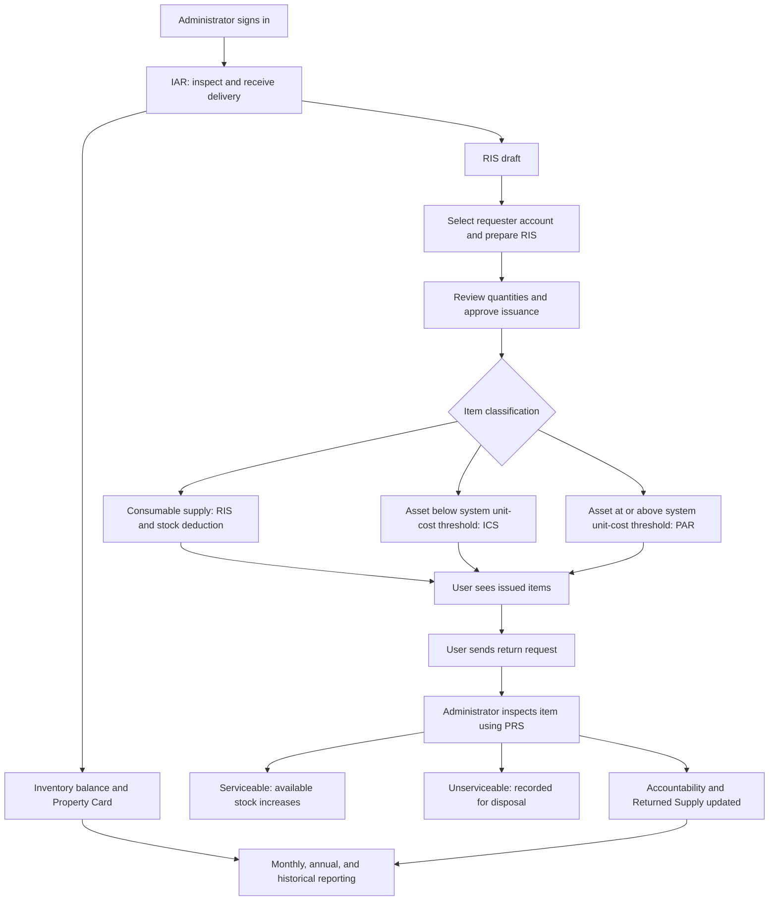

# PAMS: System Explanation and Defense Guide

Prepared from the current application routes, form pages, backend validation, workflow documentation, and Git history reviewed on October 10, 2026.

## 1. Description and purpose

The Property Accountability Management System (PAMS) is a web application for a government supply office. It organizes the receipt, issuance, custody, transfer, and return of supplies and assets, together with their supporting documents and reports.

Its purpose is to help staff answer: What was received? How much stock is available? What was issued? Who is accountable for it? Was it transferred or returned? Which document supports the transaction?

The administrator prepares documents, manages accounts, reviews issuance, verifies returns, and produces reports. Ordinary users have a focused workspace with Issued Items and Returned Items. They view records linked to their account and send return requests to the administrator. About is also accessible to users.

The frontend uses React; the backend uses Node.js and Express; MongoDB stores the records. Critical stock and custody operations use database transactions so related changes succeed together or are rolled back together. These operations require a transaction-capable MongoDB connection.

**Suggested opening statement:**

“Our system centralizes the supply office's property accountability records. It connects the receipt of an item with its issuance, assigned custodian, subsequent movement, and return. The improvement focuses on accurate stock balances, identifiable account ownership, controlled approvals, and accessible supporting documents.”

## 2. Flow of forms

1. Create or approve the employee's account so documents can link to a known person.
2. Record a delivery in the Inspection and Acceptance Report (IAR). Saving a stock receipt creates the related stock records, Property Card, and RIS draft. It does not immediately assign the delivery to an employee through ICS or PAR.
3. Use the Property Card to review receipts, issues, movements, and balances.
4. Prepare the Requisition and Issue Slip (RIS), selecting the employee's account and specifying requested quantities and purpose.
5. Review available stock and actual quantities to issue. Approval and issuance update stock and linked records together.
6. Consumables use RIS without asset accountability forms. Assets generate an Inventory Custodian Slip (ICS) or Property Acknowledgement Receipt (PAR).
7. The employee sees the request status and actual issued quantities in Issued Items.
8. For a return, the employee enters a quantity in Returned Items and sends it to the administrator. Submission alone does not restore stock or remove accountability.
9. The administrator physically checks the item, records its condition in the Property Return Slip (PRS), and confirms or rejects receipt.
10. Confirmed serviceable returns increase available stock. Unserviceable returns are recorded for disposal without increasing usable stock. Returned quantities reduce the remaining accountability.
11. Reports and Historical Records support monitoring and document retrieval.

**Transfer branch:** PTR documents movements between accountable officers. The linked custody workflow supports sender request, receiver confirmation, and administrator approval. Pending movements retain the original custodian's accountability. See section 8 for the current interface limitation before promising a complete user-operated transfer demonstration.

## 3. Common fields and buttons

### Meaning of common information

| Information | Purpose |
| --- | --- |
| Entity Name / LGU / Government Unit | Identifies the organization responsible for the record. |
| Fund Cluster / Fund | Identifies the funding source or accounting fund. |
| Office and Division | Identifies the requesting or receiving organizational unit. |
| Responsibility Center Code | Associates the transaction with the responsible organizational/accounting center. |
| Document number and date | Provides a reference for retrieval and linking documents. |
| Stock number | Identifies a stock/catalog item. |
| Property or inventory number | Identifies the recorded asset or inventory item. |
| Serial number | Distinguishes a particular physical unit when applicable. |
| Description and unit | States what the item is and how it is counted, such as piece, box, or unit. |
| Quantity and value | Measures the movement and its recorded financial amount. |
| Signatory name, position/designation, and date | Identifies the persons responsible for requesting, approving, issuing, receiving, or returning. |

Required fields are indicated in the forms. Some values are generated or copied from linked records. Optional fields should be supplied when applicable. Required fields vary by form and by whether a document is a standalone record or a controlled workflow record.

### Shared actions

| Button/control | Explanation |
| --- | --- |
| New Form | Opens a fresh document editor; opening it does not complete a stock movement. |
| Add item | Adds another item line where the form supports multiple items. |
| Edit / Update / Open form | Opens an existing record; completed workflow documents may be locked. |
| Save / Create | Validates and stores the form. The operational effect depends on the module and its links. |
| Update / Save Changes | Stores permitted corrections to an existing record. |
| Close / Cancel | Leaves the editor or dialog; it does not approve the transaction. |
| PDF / Download PDF | Downloads the saved document in its PDF layout. |
| Print | Opens the document for printing. |
| Print Preview | Shows the PDF before printing, on pages that offer this action. |
| Search | Finds matching saved records. |
| Page size, Previous, Next | Controls how many saved records appear and moves between pages. |
| Refresh / Retry | Reloads records or retries a failed load. |

PDF and Print are available on the main official document pages and report pages; the Returned Supply page principally offers record editing. Do not describe PDF, deletion, or export buttons as universal. Buttons may be disabled during saving or when a document's status prevents an action.

## 4. Forms and pages explained individually

### 4.1 Login

**Purpose:** Authenticate the person and open the appropriate workspace.

**Information:** Username and password.

**Controls:** Login submits credentials; the password visibility control reveals or hides the password; registration and forgotten-password links open their respective pages. A session-loading indicator appears while authentication is being checked.

**Defense explanation:** Authentication identifies the person performing an action, while role restrictions determine which functions that person can access.

### 4.2 Registration request

**Purpose:** Allow an employee to request access without automatically becoming an active system user.

**Information:** First name, optional middle name, last name, email, username, LGU office, division/unit, LGU position, password, and matching confirmation password.

**Controls:** Send Registration Request submits the request. The login link returns to sign-in. The administrator reviews the request in User Management and chooses Approve or Reject.

**Defense explanation:** Approval helps the supply office control who receives an account and prevents public registration from immediately granting access.

### 4.3 Forgot Password and Reset Password

**Purpose:** Restore access through a controlled recovery process.

**Information:** The recovery request uses username or email. The reset page uses the reset-link token and a new password with confirmation.

**Controls:** The recovery submission action sends the request; the reset submission action saves the replacement password; login links return to sign-in.

Ordinary user requests enter an administrator approval queue. Approval sends a one-use reset link to the registered email address. Administrator accounts use direct email recovery. Mail delivery requires configured email service settings.

### 4.4 Dashboard

**Purpose:** Give the administrator an overview and quick access to document modules.

**Information displayed:** Document totals, returned-slip and returned-supply summaries, monthly and annual report information, and recent activity.

**Controls:** Module cards and navigation links open the corresponding pages. It is primarily a monitoring page rather than a transaction-entry form.

**Defense explanation:** The dashboard helps staff identify records needing attention and navigate to the supporting documents.

### 4.5 Inspection and Acceptance Report — IAR

**Purpose:** Record a delivery's inspection and acceptance before items become available for issuance.

**Information:** Entity name, fund cluster, supplier, PO/JO number and date, responsibility center code, IAR number and date, invoice number and date; each item's stock/property number, description, unit, quantity, item classification, and cost information; applicable serial/property details; inspection date and officer/committee; receipt date, acceptance status, partial acceptance quantity when applicable, and supply/property custodian.

**Controls:** New Form starts a receipt; Add item adds delivery lines; Save IAR records a new receipt; Update IAR stores allowed corrections; Edit, PDF, and Print operate on saved reports; Close leaves the editor.

**Operational effect:** The stock-receipt operation records IAR, inventory balances, ledger entries, Property Card, and the related RIS draft together. Posted quantities, costs, stock numbers, and types cannot be changed into a different receipt. Additional stock should use another IAR.

**Numbering:** New IAR numbers are 3–4 digits, such as `001`, up to `9999`. A valid manually entered number is supported, but duplicates are rejected. The final automatic number is allocated on saving.

**Defense explanation:** Receipt verification establishes the source of stock and reduces the possibility of issuing an item that was never properly recorded.

### 4.6 Property Card

**Purpose:** Maintain an item/property ledger of recorded movements and balances.

**Information:** Month, PO number, entity name, fund cluster, property/plant/equipment name, property number, description, and optional serial number. Transaction lines include date, PAR reference, receipt quantity, issue/transfer/disposal quantity, office/officer, balance quantity, amount, and remarks. Standalone form validation also requires the relevant property and description information in its item data.

**Controls:** New Form, Edit, Add item, Save/Update, PDF, Print, and Close, together with saved-record search and paging.

**Defense explanation:** IAR proves a receipt, while the Property Card shows the item's movement record. It helps reconcile incoming stock, outgoing stock, and recorded balances.

### 4.7 Requisition and Issue Slip — RIS

**Purpose:** Record the need for supplies/assets, review what is available, and issue the approved quantities to a linked employee account.

**Information:** Entity name, fund cluster, division, responsibility center code, office, RIS number, date, and purpose. Item lines include stock number, unit, description, requested quantity, availability, actual quantity issued, and remarks. Requested By, Approved By, Issued By, and Received By include names, designations, and dates. Requested By must resolve to an account for controlled issuance.

**Controls:** New Form starts a request; row controls add or remove lines where provided; Save Request stores it; Review & Fulfill opens stock/quantity review; Save Review stores that review; Issue RIS issues reviewed items; Edit opens a pending record; the editor supports Update RIS, Reject RIS, and approval/issuance actions according to its decision and status. PDF and Print produce supporting documents.

**Operational effect:** Approval and issuance deduct stock and create the relevant linked asset forms/accountability in a transaction. Repeated issuance cannot deduct the same stock again. Insufficient stock prevents a partial set of database changes from being committed.

**Defense explanation:** Requested quantity and issued quantity are separate. A request for five units does not mean five units were actually issued.

### 4.8 Inventory Custodian Slip — ICS

**Purpose:** Document custody of assets classified by the application's lower unit-cost rule.

**Information:** Entity name, fund cluster, ICS number, office; quantity, unit, unit cost, total cost, description, inventory item number, and estimated useful life; Received From and Received By names, positions, and dates.

**Controls:** New Form, Add item, Save New Form, Save Changes, Open form/Edit, PDF, Print, and Close. An issuance-generated document may show Issued Form and restrict editing.

**Operational effect:** Asset issuance below the application's PHP 50,000 unit-cost threshold generates ICS. Total quantity multiplied by unit cost does not determine the form classification.

**Defense explanation:** ICS identifies the custodian and the items entrusted to that person. A manually saved standalone ICS should not be described as automatically equivalent to the linked stock-issuance transaction.

### 4.9 Property Acknowledgement Receipt — PAR

**Purpose:** Document custody of assets classified by the application's higher unit-cost rule.

**Information:** Entity name, fund cluster, PAR number, office; quantity, unit, description, property number, acquisition date, and amount; Received By and Issued By names, positions, and dates.

**Controls:** New Form, Add item, Save New Form, Save Changes, Open form/Edit, PDF, Print, and Close. Issued workflow forms may be locked.

**Operational effect:** Asset issuance at PHP 50,000 or more per unit generates PAR under the current application rule.

**Defense example:** Two assets costing PHP 30,000 each use ICS under this rule, although together they cost PHP 60,000. An asset costing PHP 60,000 per unit uses PAR. A consumable supply does not become an ICS/PAR asset merely because its cost is high.

This describes the implementation, not a certification that the threshold is the currently applicable rule for every government organization.

### 4.10 Property Transfer Report — PTR

**Purpose:** Document a movement from one accountable officer to another.

**Information:** Entity name, fund cluster, PTR number, sending accountable officer, receiving accountable officer, date, transfer type, reason, and remarks. Types include Donation, Reassignment, Relocation, or a specified Other. Item lines include acquisition date, property number, description, amount, and condition. Approved By, Issued By, and Received By require name, designation, and date.

**Controls:** New Form, Add item for standalone documents, Create PTR, Update PTR, Open transfer form, PDF, Print, and Close. Existing linked workflow records support decision controls and Approve PTR or Reject PTR when their state permits processing.

**Workflow purpose:** In the linked custody workflow, the receiving person confirms physical receipt before administrator approval reassigns accountability. Pending/rejected transfers leave accountability with the original custodian; approval preserves the old documents and creates the receiving custodian's linked form.

**Demonstration limitation:** The current router restricts `/transfers` to the administrator workspace. User-side sender/receiver logic exists in source/API but is not reachable from the ordinary user's current navigation. A standalone PTR documents a transfer; do not promise that saving any standalone PTR automatically reassigns live accountability.

### 4.11 Property Return Slip — PRS

**Purpose:** Verify and document the physical return of issued items.

**Information:** LGU name, PRS number, purpose (Disposal, Repair, Returned To Stock, or Other), linked returning account and exact issued item; quantity, unit, description, applicable property number, M.R./document reference, unit value, calculated total value, condition, optional note; Returned By and Returned To names, designations, and dates.

**Controls:** New Form, account/issued-item selectors, Add item when permitted, Create PRS, Update PRS, Open return form, PDF, Print, and Close. For pending workflow returns, the administrator selects the condition and decision, then uses Confirm Receipt or Reject PRS. A rejection requires a reason. Complete issuance is offered for eligible older approved RIS records awaiting actual issuance.

**Operational effect:** Confirmation updates remaining accountability, inventory status, stock where serviceable, Property Card, and Returned Supply together. Partial returns leave the remainder with the custodian. Full returns remove the completed active accountability. Repeated confirmation does not post stock twice.

**Correction rule:** Completed workflow quantities, conditions, and original custodian details are locked. Permitted Returned To signatory corrections use Update PRS without posting another stock return.

**Defense explanation:** Sending a return request is evidence of intent. The administrator's inspection and confirmation establish actual receipt.

### 4.12 Returned Supply

**Purpose:** Keep an individual record for each returned item, including rows generated from PRS.

**Information:** Linked issued item/account where available, LGU name, purpose, quantity, unit, description, applicable property number, M.R. reference, unit value, calculated total value, optional note; Returned By and Returned To names, designations, and dates.

**Controls:** New Form, Edit, issued-item/account selection, Save New Form, Save Changes, Close, search, and pagination. The current saved-record cards do not provide the same PDF/Print controls as the official slip pages.

**Operational effect:** A new entry with an exact issued-item link follows the controlled return process and creates a linked PRS. An unlinked historical document does not change inventory. A PRS-generated row must be corrected through its Return Slip. Linked/mirrored rows are counted once.

**Defense explanation:** PRS is the return document; Returned Supply provides item-level return records. They are connected views of a return rather than two independent returns to stock.

### 4.13 User Issued Items

**Purpose:** Let employees see requests and issuances linked to their own account.

**Information displayed:** Item details, requesting/issuance references, status, requested quantity, actual issued quantity, and linked ICS/PAR references where applicable.

**Controls:** Refresh reloads the list. This is a viewing page; ordinary users do not prepare administrative RIS documents here.

**Defense explanation:** Employees can distinguish pending or rejected requests from actual issued items and identify the supporting reference.

### 4.14 User Returned Items

**Purpose:** Let employees request returns and follow their return status.

**Information:** Select the available issued-item row and enter the quantity to return, within the remaining issued quantity. Linked record details are supplied by the system.

**Controls:** Send return to admin submits the quantity; Refresh reloads the records. A pending row shows Sent to admin; completed rows indicate that the return is complete.

**Defense explanation:** The user does not directly increase stock. Pending returns remain accountable until the administrator confirms physical receipt. Current accountability data also allows transferred assets to appear when their workflow has been completed.

### 4.15 Monthly Items Report

**Purpose:** Consolidate recorded item activity by the month of recording.

**Information:** Selected month, LGU, fund, serial/report number, report date, automatically populated item rows and recapitulation, supply/property custodian, designated accounting staff, and posting date.

**Controls:** Month selector, Refresh, New Form, Save Report Details or Save New Form, View for saved records, Print Preview, PDF, Print, and Close preview.

**Operational effect:** Automatic monthly reports use server-recorded items. A standalone monthly form copies the selected month's recorded rows and does not replace the automatic report.

**Defense explanation:** Report preparation reuses stored records and reduces repeated typing. Explain it as a report of recorded items, not an independently verified physical inventory count.

### 4.16 List of Property, Plant and Equipment — List of PPEs

**Purpose:** Prepare a structured list of PPEs, their accountable persons, and recorded costs.

**Information:** Local government unit, PPE account group, date; article, description, property number, accountable person, unit cost, total cost, and optional remarks; preparer's and reviewer's names and designations.

**Controls:** New Form, Add PPE, Remove row selector, Save List of PPEs, Edit, Print Preview, PDF, Print, and Close preview.

**Defense explanation:** This list supports organized PPE reporting. It does not by itself prove that every listed item was physically inspected.

### 4.17 Annual Reports

**Purpose:** Group recorded office items by item type and show quantities, offices, custodians, and supporting documents.

**Information:** Year and period choice: recorded through the selected year, or recorded in that year only. Rows display office, item, quantity, unit, property/stock number, custodian, and document reference.

**Controls:** Year, period filter, Refresh, View document, PDF, and Print for each item-type group.

**Defense explanation:** Staff can review where an item type, such as air conditioners, is assigned across offices. Approved linked transfers and confirmed returns are reflected in the calculation. Legacy records without dated movement history limit the completeness of historical year-end reconstructions.

### 4.18 Historical Records

**Purpose:** Retrieve past documents and examine related transactions.

**Information:** Selected year, record type, condition, and search terms such as item, document number, office, or employee.

**Controls:** Filters, Search, View record, related transaction-history links, Download PDF, and Close record.

**Defense explanation:** Historical retrieval supports checking the evidence behind a transaction. It depends on the records and links actually stored in the database.

### 4.19 User Management

**Purpose:** Control employee and administrator accounts, access status, registration approvals, and password recovery approvals.

**Information:** User account creation uses first name, last name, email, username, password, office, division, and access settings. Add Admin includes matching password confirmation. Registration requests also contain the employee's supplied position and other registration details.

**Controls:** Create User, Add Admin, account action menu, View Records, Edit user, Lock/Unlock, Save User Access, Cancel/Close, Previous/Next, registration Approve/Reject, and password-reset Approve/Reject.

**Defense explanation:** Stable account IDs link people to their issuances even after their display names change. Explicit selection resolves people with identical names. Account locking blocks access while retaining associated records.

### 4.20 Suppliers

**Purpose:** Store supplier reference information.

**Information:** Supplier name, address, and contact number.

**Controls:** New supplier, Save Supplier, and Retry when loading fails.

**Availability:** A supplier route exists, but it is absent from the current main sidebar. Demonstrate it only if your deployed navigation exposes it or you intentionally open the authorized route.

### 4.21 My Profile and About

**My Profile purpose:** Show the administrator's identity, office, email, username, division, role, account status, and membership date. The picture control uploads or changes a JPG, PNG, or WebP image up to 2 MB. The current page is not a general account-details editing form.

**About purpose:** Explain PAMS, its main functions and purpose, and identify its developers. Developer-profile tools support their presentation details where the administrator interface exposes them.

**Other navigation controls:** The menu expands/collapses navigation on smaller screens; the account menu opens authorized account pages; Logout ends the current session.

## 5. Recent additions and improvements

“Previous” below refers to behavior identified from this repository's recent changes and documentation. It is not a measured comparison with an institution's manual process or an undocumented earlier version.

| Area | Previous problem or improvement target | Current improvement | Defense justification |
| --- | --- | --- | --- |
| Receipt and issuance relationship | Custody forms needed to represent actual issuance rather than merely receipt. | IAR creates stock/Property Card/RIS draft; asset ICS/PAR forms are generated on issuance. | Receiving stock and assigning it to a person are distinct events. |
| Item classification | Supplies and assets require different accountability treatment. | Mixed RIS separates consumables from assets and applies the asset form rule by unit cost. | Reduces inappropriate asset forms for consumables and incorrect classification by total request value. |
| Linked account ownership | Names alone may be duplicated or changed. | Stable user IDs and explicit account selection connect issuances and returns. | Keeps accountability attached to the intended person. |
| Approval and stock consistency | Related updates could otherwise disagree or be repeated. | Transactional issuance/returns and duplicate-action protection. | Prevents a saved issuance with an unmatched stock deduction or a return counted twice. |
| Return verification | A submitted return must not immediately restore usable stock. | Administrator inspection, condition selection, confirmation/rejection, and partial-return handling. | Stock represents physically received serviceable items. |
| Transfers | Responsibility must remain clear during a movement. | Linked custody workflow retains sender accountability until receiver confirmation and approval. | Avoids a period where responsibility is unclear; user interface access still needs completion. |
| Numbering | Multiple editors could preview the same next number. | Final numbers are allocated atomically on save; old numbers are not reused. | Provides unique, traceable document references under concurrent use. |
| Form quality | Missing or invalid entries weaken document completeness. | Shared frontend validation plus backend required-field/date/number checks. | Helps catch mistakes before records are stored. |
| Registration | Access needed administrative screening. | Administrator-approved registration requests and pending-request notifications. | Lets the organization decide who should receive an account. |
| Password recovery | Recovery needed oversight for ordinary accounts. | Administrator approval/rejection and one-use emailed links. | Supports controlled recovery tied to the registered address. |
| User management | Administrators needed clearer account and record controls. | Add Admin, Create User, View Records, account editing and locks. | Makes account administration and record review more direct. |
| Reports and documents | Reports and print layouts needed easier preparation and consistent output. | Automatic monthly records, annual item-type groups, standalone forms, and A4 PDFs. | Reuses stored data and produces consistent reviewable documents. |
| Interface | Forms/tables needed to work at different screen widths. | Responsive fields, stacked tables or contained scrolling, readable fonts, and loading feedback. | Helps staff complete forms and understand system state on different devices. |
| Session interruptions | Expired sessions could interrupt IAR entry. | Session refresh/retry and same-account browser-tab IAR draft preservation. | Reduces re-entry after authentication interruptions; it is not universal draft preservation. |

The latest commits are `4f59564` (October 8, 2026: workflows, responsive forms, user management, A4 PDFs), `ab419e1` (October 9: validation, account management, profiles, dashboard), and `4457923` (October 9: approved registration, login/loading and validation refinements).

## 6. Suggested demonstration

1. Sign in as administrator and explain Dashboard and role separation.
2. Show a registration request and its review controls, or an existing employee account.
3. Prepare an IAR with one consumable and two assets at different unit costs.
4. Save it and show the resulting Property Card and RIS draft.
5. Select the employee under Requested By, complete required signatories/purpose, and review available/issued quantities.
6. Approve issuance. Show the reduced stock and generated ICS/PAR references.
7. Sign in as the employee and show Issued Items.
8. Send a partial return through Returned Items. Explain that it is pending and accountability remains.
9. Sign in as administrator, inspect the pending PRS, choose the actual condition, and confirm receipt.
10. Show the remaining accountability, returned-item record, and updated stock/report evidence.
11. Show a PDF/Print Preview and find the document in Historical Records.

Use prepared demonstration data. Do not invent inspection, approval, or receipt events for real operational records. Demonstrate transfers only after verifying the required user interfaces are accessible in your presentation build.

## 7. Defense questions and suggested answers

**What is your principal improvement?**

“The principal improvement is connected accountability. Receipt, issuance, employee ownership, and verified return use related records, so we can follow the supporting documents and remaining quantities.”

**Why are several forms necessary?**

“Each form records a different event. IAR records receipt and acceptance; the Property Card records movements; RIS records requisition and issuance; ICS/PAR identify asset custody; PTR documents transfer; PRS documents return. Their separate purposes make the responsibility at each stage clearer.”

**Why does a return require administrator confirmation?**

“A user submission does not prove physical receipt. The administrator checks the quantity and condition. Only a confirmed serviceable return becomes available stock.”

**What happens if an operation fails halfway?**

“Critical stock and custody changes run in a database transaction. If a required step fails, the related writes are rolled back. This depends on deploying MongoDB with transaction support.”

**How do you avoid double counting?**

“Issuance and return confirmation have repeat-action protection. Linked PRS and Returned Supply records represent one return, and reports avoid counting their mirrored records as separate movements.”

**Why link employees by ID?**

“Names can change and two people can share a name. The account ID keeps the issuance linked to the intended employee, while the name remains readable on the document.”

**What is the difference between a standalone form and a workflow document?**

“A standalone form records document information. A linked workflow document has validated stock or issued-item references and performs the corresponding controlled movement. We do not treat every saved document as an automatic inventory update.”

**Can the system replace physical inspection?**

“Staff still perform inspection. The system records the result, responsible people, condition, and supporting documents.”

**Is there evidence that the improvement is faster?**

“Automatic linking, report preparation, and calculations reduce repeated entry, but we need timed user evaluation to claim a specific speed improvement.”

**Is the system fully COA compliant?**

“It is designed to align with applicable government property-accountability procedures. Full compliance requires the LGU to verify the applicable official forms, thresholds, and procedures.”

**What can still be improved?**

“We can complete the user-facing acceptance/transfer interfaces, expose the Property Register through navigation, validate workflows with supply-office personnel, and evaluate QR-assisted identification. These should be presented as future work unless completed and demonstrated.”

## 8. Honest scope for the defense

- `PropertiesPage.jsx` and the property lifecycle backend contain registration/coding, custodian history, physical inventory, damage/loss, and disposal functionality. The current `App.jsx` does not route to that page. Present it as source functionality awaiting interface integration, not as a currently accessible demonstrated module.
- User ICS/PAR acceptance logic and API support exist, but ordinary users cannot currently navigate to ICS/PAR pages under the route restrictions. A click acceptance record is also not a captured handwritten signature.
- Sender and receiver transfer logic exists, but ordinary users are currently restricted from `/transfers`. Administrator PTR preparation is accessible; a full user-operated linked transfer demonstration needs route/interface integration.
- `SettingsPage.jsx`, `ReportsPage.jsx`, and `AccountabilitiesPage.jsx` exist, but the current routes redirect Settings and use the dedicated reporting pages. Do not count unused pages as additional active modules.
- A QR-code label is a future suggestion in the improvement notes, not a verified implemented feature.
- Unserviceable return status does not prove that an official disposal proceeding has been completed.
- Historical annual quantities depend on dated movement records. Legacy data may not provide a complete historical physical-stock snapshot.
- This guide describes source behavior. No live deployment, physical inspection, performance benchmark, or full test-suite run was performed while preparing it.

## 9. Closing statement for the presentation

“The improved PAMS provides a clearer connection between stock records, employee accountability, and supporting documents. Its controls address incomplete forms, ambiguous account ownership, duplicate movements, and unverified returns. Physical checking and official authorization remain the responsibility of the supply office, while the system organizes the evidence and updates related records consistently.”

## Source references

- `frontend/src/App.jsx`: active routes and role restrictions.
- `frontend/src/components/Layout.jsx`: current navigation.
- `frontend/src/pages/`: form fields, buttons, and page behavior.
- `backend/src/middlewares/validateAdminForm.js`: required administrative form information.
- `docs/custody-workflow.md` and `docs/ris-issuance.md`: linked stock/custody behavior.
- `docs/INSTRUCTOR-IMPROVEMENTS.md`: property lifecycle proposal and compliance wording.
- `README.md`: current system setup and workflow notes.
- Git commits `4f59564`, `ab419e1`, and `4457923`: recent improvement history.
